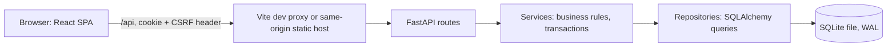

# 00. Project Overview and Conventions

> Read this file first. It is the entry point for every other spec.
> Source of truth for *what* we build is `docs/PRD.md`. These specs define *how*.

## 1. Product summary
A web app for the HR Manager of ACME (10,000 employees, 6 countries) to maintain compensation data and answer "how do we pay people?" without Excel.

Interviewer guidance (applied in these specs):
- Analytics must be meaningful, not just search and filter. The dashboard answers: average salary by country/department, min/max by job title, total salary expenditure, salary distribution across departments, and which countries/departments pay the most.
- We define our own data model and use seeded dummy data.

## 2. Scope

| In scope (PRD id) | Spec location |
|---|---|
| F1 Login / logout (single HR user, server-side session) | 02-backend sec 4, 04-frontend sec 6.1 |
| F2 Employee list (pagination, sort, search, filters) | 02-backend sec 5.3, 04-frontend sec 6.4 |
| F3 Create / edit employee | 02-backend sec 5.3, sec 7.1, 04-frontend sec 6.6 |
| F4 Reporting lines (manager, direct reports, validation) | 01-schema sec 6, 02-backend sec 7.2, 04-frontend sec 6.5 |
| F5 Deactivate / reactivate | 02-backend sec 7.1, 04-frontend sec 6.5 |
| F6 Salary history | 01-schema sec 3, 02-backend sec 7.1, 04-frontend sec 6.5 |
| F7 Bulk pay update (base, bonus or allowances; percentage or fixed annual amount; preview, then apply) | 02-backend sec 7.3, 04-frontend sec 6.7 |
| F8 Pay insights dashboard | 03-analytics, 04-frontend sec 6.3 |
| F9 Seed script (10,000 employees) | 05-seed-and-testing sec 1 |
| F10 Salary history page (all changes, search by employee and reason) | 02-backend sec 5.7, sec 7.4, 04-frontend sec 6.9 |
| F11 Currency rate management (API only, no screen) | 02-backend sec 5.8, sec 7.5 |

**Out of scope (deliberate, see PRD section 4):** a screen for managing currency rates (rates are maintained through the API, F11); payroll/tax/payments; deductions for excess leaves; audit trail (who changed what); Excel/CSV import/export; multi-user management, roles and permissions; median and percentile statistics; org chart visualisation and full-subtree rollups; live FX rates and country tax rules.

Design hooks that keep these cheap to add later: every write goes through a service method (one place to add audit logging), list filtering is a reusable query builder (export can reuse it), `hr_users` and `sessions` already exist (roles are one column).

## 3. Architecture



Rules:
- Routes are thin: parse and validate input, call one service method, shape the response.
- Services own business rules and transaction boundaries (one request = one transaction for writes).
- Repositories own SQL. No SQL in routes. No business rules in repositories.
- The browser talks to one origin (`/api/...`). In development Vite proxies `/api` to FastAPI, so no CORS is needed and cookies stay first-party.

## 4. Tech stack

| Layer | Choice | Why |
|---|---|---|
| Language | Python 3.12 | Role requirement, fast to build |
| API | FastAPI + Pydantic v2 | Typed validation, OpenAPI for frontend type generation |
| ORM / SQL | SQLAlchemy 2.x (sync) + Alembic | Sync is simplest and fast enough for SQLite; migrations are versioned |
| Database | SQLite (WAL mode) | Chosen for simplicity, as this is an interview task |
| Passwords | argon2-cffi | Modern password hashing |
| Frontend | React 18 + Vite (JavaScript) | Role requirement. Plain JavaScript, not TypeScript |
| UI library | MUI (+ MUI X DataGrid community) | Mature tables, forms and theming |
| Data fetching | TanStack Query | Caching, pagination without flicker, invalidation |
| Forms | React Hook Form + Zod | Validation that mirrors backend rules |
| Charts | Recharts | Simple bar/stacked bar charts |
| Backend tests | pytest, pytest-cov, httpx TestClient | Fast, deterministic |
| Frontend tests | Vitest, React Testing Library, MSW | No real network |
| Lint/format | ruff (Python), ESLint + Prettier (JS) | Consistent style |

Use the latest stable versions and pin them in `pyproject.toml` / lockfile.

## 5. Repository layout

```
acme-salary/
  AGENTS.md                 # rules for AI coding agents (see root file)
  README.md                 # setup, run, test, demo, trade-offs
  Makefile
  docs/
    PRD.md
    DESIGN.md               # diagrams and trade-offs (built from these specs)
    openapi.json            # API contract, generated by `make openapi` (do not edit)
  specs/                    # these files
  design/                   # DESIGN.md, stitch-prompts.md, STITCH_HANDOFF.md (UI design reference)
  opencode.json             # MCP config for the Stitch design server (no secrets)
  prompts/                  # raw AI prompt logs (one file per session)
  backend/
    pyproject.toml
    alembic.ini
    alembic/versions/
    app/
      main.py  config.py  db.py  clock.py  errors.py  security.py  deps.py
      models/        # SQLAlchemy models
      schemas/       # Pydantic request/response models
      repositories/  # SQL queries
      services/      # auth, employees, hierarchy, bulk_updates, analytics, lookups, history, currency_rates
      api/routes/    # auth, employees, bulk_updates, analytics, lookups, salary_history, currency_rates, health
      seed/          # seed package (python -m app.seed)
    tests/
      unit/  api/  conftest.py  factories.py
  frontend/
    package.json  vite.config.js
    src/
      api/  auth/  components/  pages/  hooks/  lib/  theme.js  router.jsx  main.jsx
      test/
```

## 6. Cross-cutting conventions

**Money.** Stored and transmitted as integer **cents** (USD). API field names end in `_cents`. Never use floating-point numbers for money in code. Reason: binary floats cannot represent most decimal amounts exactly (0.1 + 0.2 is not 0.3), so totals and percentage raises over 10,000 rows can drift, and SQLite has no true decimal type. Integers are exact. The frontend converts with `lib/money.js`. Local-currency amounts are display-only (see 02-backend sec 5.4).

**Dates and times.** Dates are ISO `YYYY-MM-DD`. Timestamps are UTC ISO 8601 with `Z`. "Today" always comes from an injected `Clock` (never call `date.today()` in services), so tests are deterministic.

**IDs.** Integer primary keys. Country uses its ISO 3166-1 alpha-2 code as key.

**Naming.** snake_case in Python, JSON and SQL. camelCase only inside the JavaScript code. The API client maps nothing: it keeps snake_case field names to avoid a mapping layer.

**Pagination.** `page` (1-based, default 1), `page_size` (default 25, max 100). Response: `{ "items": [...], "total": N, "page": 1, "page_size": 25 }`.

**Errors.** One JSON shape for every error:
```json
{ "error": { "code": "conflict", "message": "Email already exists", "details": { "field": "email" } } }
```
Codes: `validation_error` (422), `unauthorized` (401), `csrf_failed` (403), `not_found` (404), `conflict` (409), `stale_preview` (409), `result_too_large` (422), `rate_limited` (429), `internal_error` (500).

**Logging.** Structured logs with request id, method, path, status, duration. Never log salary amounts, passwords, session tokens or CSRF tokens.

**Configuration** (`.env`, with `.env.example` committed, `.env` gitignored):
```
DATABASE_URL=sqlite:///./data/acme.db
COOKIE_SECURE=false            # true in any HTTPS environment
SESSION_COOKIE_NAME=acme_session
SESSION_ABSOLUTE_HOURS=8
SESSION_IDLE_MINUTES=60
LOGIN_MAX_FAILURES=5
LOGIN_WINDOW_MINUTES=15
BULK_MIN_PERCENT=-50
BULK_MAX_PERCENT=100
MAX_PAGE_SIZE=100
SEED_HR_EMAIL=hr@acme.example
SEED_HR_PASSWORD=             # empty = generate a random one and print it once
SEED_RANDOM_SEED=42
```
No default password is committed anywhere.

**Make targets.** `make setup`, `make backend` (uvicorn reload), `make frontend` (vite), `make migrate`, `make seed`, `make test` (backend + frontend), `make test-watch` (re-runs tests on change, for the TDD loop), `make lint`, `make openapi` (export the API contract to `docs/openapi.json`).

## 6a. Deployment readiness
The app will be deployed later. The design keeps that cheap:
- All configuration comes from environment variables (`00` sec 6); nothing is hard-coded for one machine.
- Browser and API share one origin in every environment (dev proxy now, reverse proxy or static mount when deployed), so the same cookie and CSRF rules apply everywhere. Set `COOKIE_SECURE=true` whenever the site is served over HTTPS.
- Migrations run with `alembic upgrade head` as a start-up step; the SQLite file path is configurable so it can sit on a persistent volume.
- `GET /api/health` is available for platform health checks.
- Known single-process limits are documented: the in-memory login rate limiter and SQLite's single writer. Moving to Postgres or multiple workers means replacing those two pieces (`01` sec 9).

## 7. Non-functional targets (verified on the seeded 10k dataset)

| Target | Value |
|---|---|
| Employee list request (filtered, sorted, paginated) | under 150 ms p95 on the seeded 10k dataset |
| Each analytics request | under 100 ms |
| Seed script, 10,000 employees + history | under 15 s |
| Backend test suite | under 30 s |
| Frontend test suite | under 30 s |

## 8. Development approach and commit plan

**Method.** Test-driven development (TDD) in **vertical slices**. First the shared setup for backend and frontend, then one feature at a time: each feature is built end to end (backend, then frontend) and committed before the next feature starts. The history therefore shows working features being delivered one by one, not "all backend, then all frontend". The TDD loop and rules are in `05-seed-and-testing.md` sec 1a.

**How a slice runs.**
1. Pick the next slice from the table and read its spec sections and its Stitch screen.
2. Backend commit: write the failing tests (service tests, then API tests), make them pass, refactor, run `make openapi`.
3. Frontend commit: write the failing tests (with MSW handlers from the API contract), make them pass, refactor.
4. Smoke test the feature in the browser against the seeded database.
5. Save the prompts in `prompts/`, then start the next slice.

Commit message format (details in `AGENTS.md`): `feat(F2): employee list API (spec 02 sec 5.3)` with a body line `Tests first: ...`.

### 8.1 Foundation (shared setup)

| # | Commit | Spec | First tests to write |
|---|---|---|---|
| 1 | chore: scaffold repo, PRD, specs, design docs, AGENTS.md, Makefile, `.env.example` | n/a | n/a |
| 2 | chore(backend): FastAPI setup with config, DB engine and PRAGMAs, error handler, `Clock`, request-id logging, pytest and ruff config, health route | 02 sec 1-3, sec 8, sec 11 | health returns ok; errors use the standard shape; `foreign_keys` is on; fixed `Clock` |
| 3 | chore(frontend): Vite + React (JavaScript) setup with MUI theme from `DESIGN.md`, router, app shell skeleton, API client, `lib/money.js`, Vitest + RTL + MSW | 04 sec 1-5 | money format and parse cases; API client maps errors, adds the CSRF header on POST, handles 401; shell shows the nav links |
| 4 | feat(db): schema migration, seed script (10,000 employees) and lookups endpoint | 01, 05 sec 1, 02 sec 5.2 | CHECK constraints reject bad rows; migration schema equals `create_all`; small seed is deterministic and passes `--verify`; lookups returns countries, departments, titles and rates |

### 8.2 Feature slices

Each slice has a backend commit (B) and a frontend commit (F).

| Slice | # | Commit | Spec / Stitch screen | First tests to write |
|---|---|---|---|---|
| S1 Login and logout (F1) | 5 B | feat(F1): auth API: login, logout, me, sessions, CSRF, rate limit | 02 sec 4 | wrong password and unknown email give the same message; cookie flags; missing CSRF returns 403; rate limit; session expiry with a fixed clock |
| | 6 F | feat(F1): login page, auth provider, protected routes, logout | 04 sec 6.1-6.2 / `01 Login` | success redirects; 401 shows the generic error; signed-out user is redirected; logout clears state |
| S2 Employee list (F2) | 7 B | feat(F2): employee list API with filters, sort, pagination | 02 sec 5.3 | default status active; each filter; bad `sort_by` returns 422; stable pages; `page_size` over 100 returns 422 |
| | 8 F | feat(F2): employees page with filters and DataGrid | 04 sec 6.4 / `03 Employees` | rows render; debounced search sends one request; filter change resets page; URL restores state |
| S3 Employee detail (F4, F6) | 9 B | feat(F4,F6): employee detail, direct reports and history APIs | 02 sec 5.3-5.4 | local amount uses the country rate (round half up); direct reports pagination; history newest first with `previous` null on hire; 404 |
| | 10 F | feat(F4,F6): employee detail page with reporting and salary timeline | 04 sec 6.5 / `04 Employee detail` | history shows old and new values; local-currency note; not-found state |
| S4 Create employee (F3, F4) | 11 B | feat(F3,F4): create employee API with manager validation and hire history | 02 sec 5.3, sec 7.1-7.2 | writes employee plus one `hire` row; duplicate email 409; manager must exist and be active; self and cycle rejected; extra fields rejected |
| | 12 F | feat(F3): create employee form | 04 sec 6.6 / `05 Employee form` | validation messages; dollars become cents; email conflict shows a field error; no double submit |
| S5 Edit employee (F3, F6) | 13 B | feat(F3,F6): edit employee API with pay-change history | 02 sec 5.3, sec 7.1 | pay change writes one history row with previous values; non-pay change writes none; no-op writes none; explicit null manager; cycle on manager change |
| | 14 F | feat(F3): edit mode with changed-fields-only update and reason | 04 sec 6.6 | only changed fields are sent; reason field appears on pay change; discard prompt |
| S6 Deactivate and reactivate (F5) | 15 B | feat(F5): deactivate and reactivate API | 02 sec 7.1 | blocked with active reports; allowed after reassigning; reactivate blocked when the manager is inactive; excluded from the default list |
| | 16 F | feat(F5): deactivate and reactivate actions | 04 sec 6.5 | confirm dialog; 409 message stays in the dialog; Reactivate shown for inactive employees |
| S7 Bulk pay update (F7) | 17 B | feat(F7): bulk update preview and apply API | 02 sec 5.5, sec 7.3 | percent math and rounding; fixed amount; only the chosen component changes; unchanged employees excluded; stale preview rolls back; one shared `batch_id` |
| | 18 F | feat(F7): bulk update flow | 04 sec 6.7 / `06 Bulk update` | no apply before preview; helper text per method; sends `expected_count`; stale preview returns to the preview step |
| S8 Salary history page (F10) | 19 B | feat(F10): salary history search API | 02 sec 5.7, sec 7.4 | each filter alone and combined; `%` and `_` treated literally; inclusive date range; batch filter |
| | 20 F | feat(F10): history page | 04 sec 6.9 / `08 History` | filters sent as URL params; debounce; removable batch chip; dash for unchanged components |
| S9 Currency rates (F11) | 21 B | feat(F11): currency rate CRUD API (no UI) | 02 sec 5.8, sec 7.5 | create, duplicate and bad code; USD protected; deleting a used currency returns 409; a changed rate shows in lookups and local amounts |
| S10 Dashboard A (F8) | 22 B | feat(F8): analytics summary and breakdown APIs | 03 sec 3.1-3.2 | golden-dataset numbers; measure base versus total; inactive excluded; empty data returns zeros |
| | 23 F | feat(F8): dashboard controls, KPI cards, pay mix, average charts | 04 sec 6.3 items 1-4 / `02 Dashboard` | compact money format; measure toggle refetches; empty states |
| S11 Dashboard B (F8) | 24 B | feat(F8): salary distribution API | 03 sec 3.3 | a value on a band edge lands in the higher band; zero-filled bands; group sums equal headcount |
| | 25 F | feat(F8): distribution chart and job-title table | 04 sec 6.3 items 5-6 | department and country toggle; sortable table |
| S12 Dashboard C (F8) | 26 B | feat(F8): outliers and team analytics APIs | 03 sec 3.4-3.5 | threshold and `min_peers`; sorted by ratio; team with no reports returns zeros |
| | 27 F | feat(F8): outlier table and team summary on the employee page | 04 sec 6.3 item 7, sec 6.5 | outlier rows link to the employee; team line shown only for managers |

### 8.3 Finish

| # | Commit | Notes |
|---|---|---|
| 28 | test: query-plan tests, performance smoke on the 10k seed, security checklist tests, hardening | 01 sec 8, 05 sec 2, 02 sec 9 |
| 29 | docs: README (setup, run, test, currency API with `curl`), `docs/DESIGN.md` (diagrams, trade-offs, how AI was used), demo script | record the demo video |

Suggested pacing: commits 1-10 on day 1 (foundation, login, list, detail), 11-20 on day 2 (create, edit, deactivate, bulk update, history), 21-29 on day 3 (currency API, dashboard, hardening, docs). If time runs short, cut in this order: Dashboard C, History page filters, Dashboard B. Never cut tests.

## 9. Definition of done (per commit)
- Tests were written first and the commit message lists them (`Tests first: ...`).
- Code follows the layering rules in section 3.
- The suite is green and `make lint` is clean.
- No money floats, no SQL in routes, no secrets in the repo.
- The related spec section is updated if behaviour changed.
- The AI prompt used is saved in `prompts/`.
- A slice is done only when its backend and frontend commits are green and the feature works end to end against the seeded database.

## 10. Decisions made (change only with a reason)
1. Money as integer cents, USD only.
2. Sync SQLAlchemy with FastAPI sync endpoints.
3. Lookup tables for country, department and job title (consistent filters, small integer joins).
4. Job titles are global, not tied to a department; the seed keeps them realistic. Trade-off: the app does not enforce title/department consistency.
5. Current compensation is stored on `employees`; `salary_history` is append-only.
6. All compensation changes take effect today (no backdating or scheduling), so "current = latest history row" always holds.
7. A bulk update changes one pay component (base, bonus or allowances) at a time, by a percentage or a fixed annual amount. One-off or monthly payments are not modelled, because amounts are annual and payroll is out of scope.
8. Currency rates are managed through the API only; there is no screen, because HR does not need to change them in the app.
9. The frontend is plain JavaScript, not TypeScript. We give up compile-time type checking, and make up for it with tests written first, Zod validation on forms, JSDoc for shared shapes, ESLint, and the API contract in `docs/openapi.json` for the MSW handlers.
