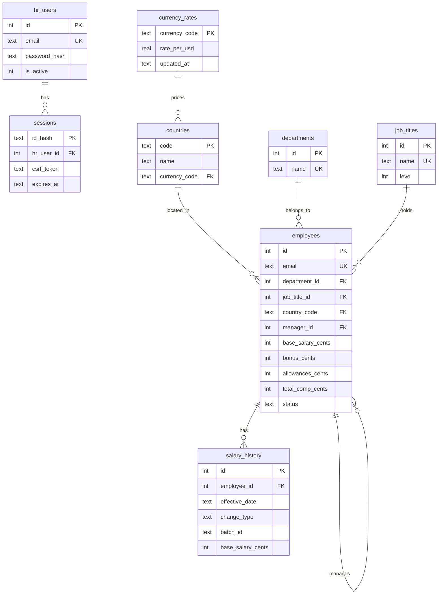

# 01. Database Schema (SQLite)

## 1. Design principles
1. **Integer money.** All amounts are integer cents in USD. Floating-point numbers cannot store most decimal values exactly, so sums and percentage raises over 10,000 rows could drift; integers are exact, and SQLite has no real decimal type.
2. **Lookup tables** for country, department and job title. Filters use small integer keys, dropdowns come from one source, and `GROUP BY` runs on integers.
3. **Current state on `employees`, history in `salary_history`.** Reads of the current salary (list, analytics) never touch history. History is append-only.
4. **Derived total is stored.** `total_comp_cents` is a stored generated column, so analytics and sorting use one column and stay consistent.
5. **Soft delete only.** Employees are deactivated, never deleted, so history and reporting lines stay intact.
6. **Constraints in the database** for anything checkable on a single row (positive amounts, valid status, no self-manager). Cross-row rules live in services and are tested.
7. **Few, purposeful indexes.** Each index below names the query it serves. Extra indexes slow the bulk update and seed.

## 2. ER diagram



## 3. Tables (DDL)

Timestamps are UTC ISO 8601 text. Dates are `YYYY-MM-DD` text. SQLite compares both correctly as strings.

```sql
CREATE TABLE hr_users (
  id            INTEGER PRIMARY KEY,
  email         TEXT NOT NULL COLLATE NOCASE UNIQUE,
  full_name     TEXT NOT NULL,
  password_hash TEXT NOT NULL,
  is_active     INTEGER NOT NULL DEFAULT 1 CHECK (is_active IN (0, 1)),
  created_at    TEXT NOT NULL
);

CREATE TABLE sessions (
  id_hash      TEXT PRIMARY KEY,            -- sha256 hex of the random token in the cookie
  hr_user_id   INTEGER NOT NULL REFERENCES hr_users(id) ON DELETE CASCADE,
  csrf_token   TEXT NOT NULL,
  created_at   TEXT NOT NULL,
  last_seen_at TEXT NOT NULL,
  expires_at   TEXT NOT NULL                -- absolute expiry
);
CREATE INDEX idx_sessions_user    ON sessions(hr_user_id);
CREATE INDEX idx_sessions_expires ON sessions(expires_at);

CREATE TABLE currency_rates (
  currency_code TEXT PRIMARY KEY CHECK (length(currency_code) = 3),
  rate_per_usd  REAL NOT NULL CHECK (rate_per_usd > 0),   -- local units per 1 USD
  updated_at    TEXT NOT NULL
);

CREATE TABLE countries (
  code          TEXT PRIMARY KEY CHECK (length(code) = 2),
  name          TEXT NOT NULL UNIQUE,
  currency_code TEXT NOT NULL REFERENCES currency_rates(currency_code)
);

CREATE TABLE departments (
  id   INTEGER PRIMARY KEY,
  name TEXT NOT NULL UNIQUE
);

CREATE TABLE job_titles (
  id    INTEGER PRIMARY KEY,
  name  TEXT NOT NULL UNIQUE,
  level INTEGER NOT NULL CHECK (level BETWEEN 1 AND 7)
);

CREATE TABLE employees (
  id                INTEGER PRIMARY KEY,
  full_name         TEXT NOT NULL,
  email             TEXT NOT NULL COLLATE NOCASE UNIQUE,
  department_id     INTEGER NOT NULL REFERENCES departments(id),
  job_title_id      INTEGER NOT NULL REFERENCES job_titles(id),
  country_code      TEXT    NOT NULL REFERENCES countries(code),
  manager_id        INTEGER REFERENCES employees(id),
  hire_date         TEXT NOT NULL,
  status            TEXT NOT NULL DEFAULT 'active' CHECK (status IN ('active', 'inactive')),
  base_salary_cents INTEGER NOT NULL CHECK (base_salary_cents > 0),
  bonus_cents       INTEGER NOT NULL DEFAULT 0 CHECK (bonus_cents >= 0),
  allowances_cents  INTEGER NOT NULL DEFAULT 0 CHECK (allowances_cents >= 0),
  total_comp_cents  INTEGER GENERATED ALWAYS AS
                      (base_salary_cents + bonus_cents + allowances_cents) STORED,
  created_at        TEXT NOT NULL,
  updated_at        TEXT NOT NULL,
  CHECK (manager_id IS NULL OR manager_id <> id)
);

CREATE TABLE salary_history (
  id                     INTEGER PRIMARY KEY,
  employee_id            INTEGER NOT NULL REFERENCES employees(id),
  effective_date         TEXT NOT NULL,
  change_type            TEXT NOT NULL CHECK (change_type IN ('hire', 'manual_edit', 'bulk_update')),
  reason                 TEXT,
  batch_id               TEXT,                       -- uuid, set for bulk_update rows only
  base_salary_cents      INTEGER NOT NULL,           -- values AFTER the change
  bonus_cents            INTEGER NOT NULL,
  allowances_cents       INTEGER NOT NULL,
  prev_base_salary_cents INTEGER,                    -- values BEFORE the change; NULL for 'hire'
  prev_bonus_cents       INTEGER,
  prev_allowances_cents  INTEGER,
  created_at             TEXT NOT NULL
);
```

Implementation notes:
- In SQLAlchemy, declare `total_comp_cents` with `Computed("base_salary_cents + bonus_cents + allowances_cents", persisted=True)` and never write it. Use the same expression in the Alembic migration. A stored generated column must be created in `CREATE TABLE` (it cannot be added later with `ALTER TABLE`), so it is in the initial migration.
- Money upper bound is enforced in Pydantic (`MAX_AMOUNT_CENTS = 1_000_000_000`, i.e. $10M), not in SQL.
- `change_type` and `status` are text with CHECK constraints (readable in the DB, no extra table).

## 4. Indexes

| Index | Columns | Serves |
|---|---|---|
| (unique) | `employees.email` NOCASE | Duplicate check, lookup by email |
| `idx_emp_status_country` | `(status, country_code)` | List filtered by status and country; analytics `WHERE status='active'` grouped by country |
| `idx_emp_status_dept` | `(status, department_id)` | List filtered by department; analytics by department |
| `idx_emp_title` | `(job_title_id)` | Filter and analytics by job title; outlier peer groups |
| `idx_emp_manager` | `(manager_id)` | Direct reports, "has active reports" check, manager filter, team view |
| `idx_emp_name` | `(full_name COLLATE NOCASE)` | Sorting by name |
| `idx_history_employee_effective` | `salary_history(employee_id, effective_date DESC, id DESC)` | Employee history timeline, latest row |
| `idx_history_batch` | `salary_history(batch_id) WHERE batch_id IS NOT NULL` | Look up all rows of one bulk update |
| `idx_history_effective` | `salary_history(effective_date DESC, id DESC)` | History page: default sort and date-range filter across all employees |
| `idx_sessions_user`, `idx_sessions_expires` | sessions | Logout everywhere, expiry cleanup |

Notes:
- **Search (`q`)** uses `LIKE '%term%'` on name and email. That is a scan, which is about 10 to 20 ms on 10,000 rows, so it is acceptable. At larger scale use SQLite FTS5 or Postgres trigram indexes.
- **History search** (`employee`, `reason`) also uses `LIKE '%term%'`: reasons are scanned on about 30,000 history rows and employee names through the join. That is a few milliseconds to a few tens of milliseconds, so it is acceptable. At larger scale use FTS5 or trigram indexes.
- **Sorting by `total_comp_cents`** on 10,000 rows is an in-memory sort and is fast; it does not need its own index.
- **Analytics** aggregate over active employees. At this size a scan or the status indexes are enough. Do not add covering indexes unless a measured query misses its target.

## 5. Integrity rules and invariants

Enforced in the database (CHECK, FK, UNIQUE): positive base salary, non-negative bonus/allowances, valid status, no self-manager, unique email (case-insensitive), valid country/department/title.

Enforced in services (cross-row), each with a unit test:
1. **Current = latest history.** After every write, `employees.{base,bonus,allowances}` equal the newest `salary_history` row (highest `effective_date`, then `id`). Create writes a `hire` row; manual edit and bulk update write one row per changed employee. Both happen in the same transaction as the employee update.
2. **No backdating.** Every change takes effect today (from the injected `Clock`). The seed script is the only code that writes past dates.
3. **No cycles.** A manager assignment must not create a loop (query in section 6).
4. **Manager must be active.** An employee's manager must exist and be `active` when assigned.
5. **No orphaned active reports.** An employee with active direct reports cannot be deactivated.
6. **Reactivation needs an active manager** (or no manager).
7. **History is append-only.** Repositories expose insert and read only; no update or delete.
8. **Every country has a currency rate** (FK guarantees it).

## 6. Hierarchy queries

Would assigning `:new_manager` to `:emp` create a cycle? Walk up from the new manager; if the chain reaches `:emp`, it would. `UNION` (not `UNION ALL`) stops the recursion if bad data ever contains a loop.

```sql
WITH RECURSIVE chain(id) AS (
  SELECT :new_manager
  UNION
  SELECT e.manager_id FROM employees e JOIN chain c ON e.id = c.id
  WHERE e.manager_id IS NOT NULL
)
SELECT 1 FROM chain WHERE id = :emp LIMIT 1;
```

Direct reports (paginated): `SELECT ... FROM employees WHERE manager_id = :id AND (:status IS NULL OR status = :status)` (uses `idx_emp_manager`).

Has active reports: `SELECT EXISTS(SELECT 1 FROM employees WHERE manager_id = :id AND status = 'active')`.

Hierarchy depth in the seed is 5 levels, so these queries are trivial.

## 7. Migrations and connection settings

- One initial Alembic migration creates everything above. Tests create the schema from the same migration (or `metadata.create_all` against an in-memory DB; both must produce the same schema, and a test compares them).
- Set these on **every** new SQLite connection (SQLAlchemy `connect` event):
  ```
  PRAGMA foreign_keys = ON;
  PRAGMA journal_mode = WAL;
  PRAGMA synchronous = NORMAL;
  PRAGMA busy_timeout = 5000;
  ```
- Database file lives in `backend/data/` (gitignored). Tests use `sqlite://` in memory.

## 8. Query plans to verify (automated test in 05 sec 2)

Run `EXPLAIN QUERY PLAN` on the seeded database and assert the plan text contains the index name:
1. List with `status='active' AND country_code=?` mentions `idx_emp_status_country`.
2. List with `manager_id=?` mentions `idx_emp_manager`.
3. History for one employee mentions `idx_history_employee_effective` and has no temp B-tree for sorting.
4. Direct-reports count mentions `idx_emp_manager`.
5. History list with default sort (no filters) mentions `idx_history_effective` and has no temp B-tree for sorting.

If SQLite prefers a different index for a combined filter, that is fine as long as the query meets the latency target; the test asserts only the four cases above.

## 9. Capacity and future changes
- 10,000 employees at about 150 bytes plus indexes is a few MB. History is about 25,000 to 30,000 rows. The database file stays well under 20 MB.
- **Moving to Postgres:** `INTEGER` cents become `BIGINT`; generated column syntax is the same idea; `COLLATE NOCASE` becomes `citext` or a lower() index; median and percentiles become possible with `percentile_cont`; add trigram indexes for search.
- **Changing the pay structure later.** Today the three components (base, bonus, allowances) are columns, as fixed by the PRD. This keeps analytics a plain `SUM` over one generated column, enforces types and constraints, and needs no joins. If a component is added occasionally, it is one migration (new column with default 0, updated generated total, matching history columns). If components become many, country-specific or HR-defined, move to rows: `pay_components(id, code, name)` plus `employee_pay(employee_id, component_id, amount_cents)` (and the same shape for history), and sum over rows. The cost is joins, pivoting and a more complex total, so do it only when the structure really changes often.
- **Adding an audit trail later:** add an `audit_log` table (actor `hr_user_id`, entity, action, field, old/new, timestamp, optional `batch_id`) and write to it from the service methods that already wrap every change. No existing table needs to change.
